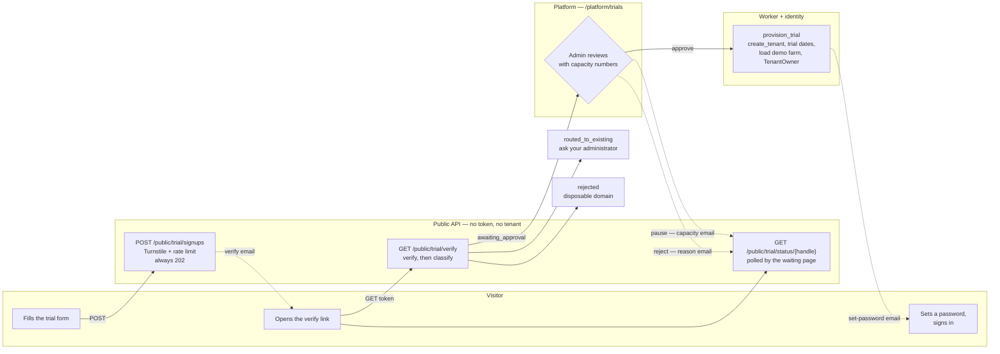
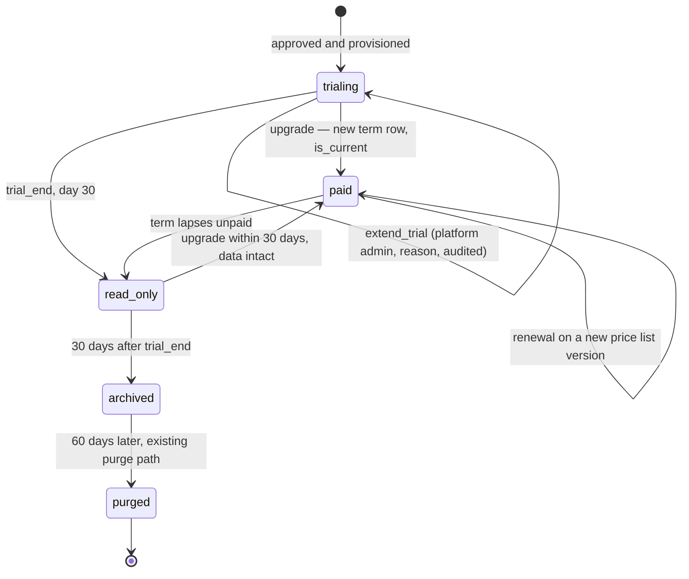
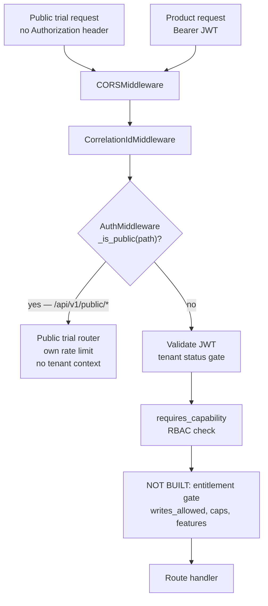

# Self-serve trial — plan, status and remaining work

Status: in progress. The API half is merged and deployed (PR #631, released to
production in PR #636 on 2026-08-28). The website form, the review screen, the
entitlement gate, the trial clock and the demo farm hand-off are not built.
§ 0 has the full list.

This file merges three sources, and it replaces the trial parts of each:

- the first draft of this file, branch `docs/self-serve-trial-flow`
  (commit `60edfe4d`, 2026-08-27), never merged;
- § 7, § 10 and § 15 of `docs/proposals/subscription-billing-and-self-serve-trial.md`.
  That file stays authoritative for pricing, the rate card, the meter and
  invoices. For the trial, this file wins;
- the demo farm decisions in `docs/proposals/demo-farm-history-generation.md`
  and the delivery steps 13 to 15 in `docs/proposals/demo-dataset-build-guide.md`.

Scope: Prompt 8 in `prompts/roadmap.md`, steps 3 and 4 of the build order in the
billing plan.

Decisions in § 9 were settled with Mohamed on 2026-08-27. The demo farm
decisions were taken on 2026-09-03 and replace § 3.3 of the first draft.

---

## 0. Status

Checked against `origin/main` at `dc088c2e` on 2026-10-23, by reading the code.
Nothing below was run for this document.

### Built

| Item | Where |
|---|---|
| `public.trial_signups` table, state CHECK, one live request per address and per company domain | `backend/migrations/public/versions/0078_trial_signups.py` |
| `POST /api/v1/public/trial/signups`, `GET /verify`, `GET /status/{handle}` | `backend/app/modules/billing/public_router.py` |
| `/api/v1/public/` added to the public prefixes | `backend/app/shared/auth/middleware.py` |
| Turnstile check, rate limits per IP and per email domain | `billing/turnstile.py`, `backend/app/shared/ratelimit.py` |
| Verify step: routes to an existing tenant, rejects disposable domains, queues the rest | `billing/service.py` `verify` |
| `GET /api/v1/platform/trials` with capacity numbers, approve, pause, reject | `billing/trials_router.py` |
| Approval caps of 3 a day and 10 a week. Past a cap, approve needs a reason; the audit row carries both counts | `billing/service.py` `approve` |
| Capabilities `platform.trial.read` and `platform.trial.manage` | `shared/rbac`, `frontend/src/rbac/capabilities.ts` |
| `billing.provision_trial`: unique slug, `create_tenant`, success only when Keycloak succeeded, retries, `failed` after the last attempt | `billing/tasks.py` |
| Trial dates and caps written onto the current `tenant_subscriptions` row | `billing/tasks.py` `_write_trial_term` |
| `billing.chase_unreviewed_trials`: one "still reviewing" mail after 24 hours | `billing/tasks.py` |
| Trial requester data removed by the tenant purge | `backend/app/shared/purge/registry.py` |
| `farms.is_demo` and `farms.demo_frozen_at` | tenant migration `0091_demo_farm_flags.py` |
| Trial capacity numbers leave out the demo farm | `billing/repository.py` `trial_usage` |
| Demo history replay on the internal build tenant, rebuilt from 2024-01-01 | PRs #695 to #763 |
| Trial and Turnstile settings, the three base URLs in Helm | `core/settings.py`, `infra/helm/api`, `infra/helm/workers` |

### Not built

| # | Item | Section |
|---|---|---|
| 1 | Website pages: `trial.astro`, `trial/check-your-email.astro`, `trial/status.astro`. `contact.astro` still posts to a `mailto:` link | § 3, stage 1 |
| 2 | `/platform/trials` review screen | § 3.1 |
| 3 | `POST /api/v1/platform/trials/{id}/resend-verification` | § 7.2 |
| 4 | Platform alert when provisioning ends in `failed`. Today it is one error log line | § 5 |
| 5 | Demo snapshot export, fast loader, and the loader call from `provision_trial` | § 3.3 |
| 6 | `Deploy demo farm` choice when a platform admin creates a tenant | § 3.3 |
| 7 | Entitlement gate. The caps are stored in `feature_flags` and read by nothing | § 6 |
| 8 | Trial clock: D−7 and D−1 mails, read-only at `trial_end`, archive 30 days later, demo farm freeze | § 4 |
| 9 | Extend trial, with reason and audit | § 4 |
| 10 | Upgrade to a paid term, and the customer billing page | § 4 |
| 11 | In-app trial banner and the read-only state | § 7.4 |
| 12 | `price_list_id` on the trial term. There is no price list table yet | billing plan § 14, step 1 |
| 13 | Roadmap Prompt 8, criterion 1, reworded for the approval gate | § 1 |

### Known gaps in what is built

- `TURNSTILE_SECRET_KEY` is not set in Helm. An empty secret turns the check
  off, so production has no anti-robot check today.
- The approval email links to the app root, not to a set-password page. The
  password itself comes from the Keycloak invite. Check that the visitor gets
  one clear message, not two that disagree.
- The trial length, caps and limits live in `core/settings.py`. Decision 10 of
  the billing plan says every number is editable in the interface. They move
  when the price list tables exist.
- `_write_trial_term` uses `date.today()`, not the central clock helper added
  for the demo replay.
- The trial product mails go through the notifications SMTP path. That path had
  never sent to a person outside a tenant before this work. Not tested in
  production.

---

## 1. What we are building

A visitor on the marketing site fills a form, verifies their email, and waits
for a platform admin to approve the request. On approval their tenant is
provisioned with a demo farm next to it, and they sign in. The trial then ends
in one of three ways: it expires, it is extended, or it becomes a paid plan.

This is the standard product-led trial pattern with one deliberate change — the
approval gate:

1. Form with no credit card.
2. Double opt-in — the email address is verified before anything is created.
3. **A platform admin approves, pauses or rejects each verified request.**
4. Provisioning then runs asynchronously; the visitor watches a status page.
5. Onboarding inside the product, next to a demo farm with two years of history.
6. Expiry turns the tenant read-only. Data is kept, not deleted.
7. Upgrade happens inside the product, with sales able to help.

**This conflicts with the roadmap gate.** Prompt 8, criterion 1, says a visitor
who has spoken to no one reaches a working signed-in tenant with no human in the
loop. With the approval gate that is no longer true, and the gate line in
`prompts/roadmap.md` needs rewording before Prompt 8 is called done.

The reason for the gate is cost and capacity. Every tenant is a Postgres schema
plus a Keycloak group, and a trial that draws a farm starts imagery and weather
fetches that cost real money. Approval caps are 3 tenants a day and 10 a week.

The same demo farm serves sales demos. A platform admin creating a tenant by
hand gets a `Deploy demo farm` choice. A trial gets the farm by default.

---

## 2. The access boundary

The visitor must never reach the platform admin area. This is true by
construction, and the trial flow must not weaken it.

- Platform access is decided by `platform_role` in the JWT
  (`backend/app/shared/auth/context.py`), read by `AuthMiddleware`
  (`backend/app/shared/auth/middleware.py`) and checked by the capability
  registry (`backend/app/shared/rbac/check.py`).
- A self-serve owner is created through the same path as an invited owner:
  `create_tenant` calls `TenantUsersService.invite_user(...,
  tenant_role="TenantOwner")`. That path writes a tenant membership and a
  tenant role. It writes no platform role.
- So every `/api/v1/platform/*` route returns 403 for a trial owner, and the
  frontend platform routes have nothing to render.

Two rules the built code follows, and later work must keep:

1. **The public endpoints run with no `RequestContext`.** They cannot call
   anything that expects an actor with capabilities. The provisioning task runs
   as a system actor, `actor_user_id=None`.
2. **Provisioning is reachable only from an approval.** Not from the signup
   POST, and not from the verify link. The approving admin's user id is in the
   audit row.

---

## 3. The flow, stage by stage

### Diagram — from the form to a signed-in tenant

Dashed arrows are emails. `routed_to_existing` and `rejected` create no tenant
and never reach the queue.

### Stage 1 — the form

Status: not built.

Lives on the marketing site (`marketing/src/pages/`, Astro on Cloudflare
Workers). Fields: full name, work email, organisation, country, phone
(optional), accept terms. A Cloudflare Turnstile token is posted with it. The
site is already on Cloudflare, so this needs no third-party script.

There is a parked pricing page at `marketing/src/pages/_pricing.astro.parked`.
The trial form and that page ship together. The "request a demo" form on
`contact.astro` should link to the trial form once it exists.

### Stage 2 — `POST /api/v1/public/trial/signups`

Status: built.

Validates, verifies the Turnstile token, rate-limits by IP and by email domain,
writes a `public.trial_signups` row with status `pending_verification`, and
sends a signed, single-use, expiring verification link. The link lives 48
hours.

**Always returns 202 with the same body**, whether or not the address is
already known. Anything else lets a stranger enumerate our customers.

### Stage 3 — `GET /api/v1/public/trial/verify?token=…`

Status: built.

Marks the signup `verified`, then classifies it:

| Condition | Result | Reaches the queue |
|---|---|---|
| Email domain matches an active tenant | `routed_to_existing` — page says to ask their administrator | No |
| Disposable domain on the blocklist | `rejected` | No |
| Everything else, free-mail included | `awaiting_approval` | Yes |

Free-mail addresses go to the queue like any other. Many growers use Gmail. The
automatic checks exist to keep junk off the queue, not to make the decision.

The visitor is told, on the page and in an email, that the request is reviewed
**within one working day**, and is given a status link they can reopen.

### Stage 4 — platform review

Status: API built, screen not built.

A platform admin opens `/platform/trials`, reads the capacity numbers, and
approves, pauses or rejects. Detail in § 3.1.

### Stage 5 — provisioning, in Celery

Status: built, except steps 3 (price list) and 4 (demo farm).

Triggered by approval only.

1. Generate a slug from the organisation name, with a numeric suffix on
   collision. A visitor must never see a 409.
2. `create_tenant(initial_tier="free", owner_email=…, actor_user_id=None)`.
3. Write `trial_start = today`, `trial_end = today + 30 days` and the caps.
   Pin `price_list_id` once the price list tables exist.
4. **Load the demo farm** from the current snapshot, with its dates rebased to
   today. See § 3.3.
5. **Report success only when Keycloak provisioning succeeded.** See § 5.
6. Send the set-password email and mark the signup `provisioned`.

Step 4 must not block the visitor. If the load fails, the tenant is still
provisioned and the failure shows on `/platform/trials` with a retry button.
An empty tenant is worse than a slow one, but it is better than no tenant.

### Stage 6 — first sign-in

The owner sets a password, signs in with the `TenantOwner` role, and lands on
the demo farm with an "add your farm" step next to it. Trial caps apply from
that first minute: 100 feddan, 2 farms, 5 seats. The demo farm counts against
none of them.

### 3.1 The approval screen

Status: not built. The API returns every number below except "failed
provisioning" as its own count.

`/platform/trials` is a queue, not a monitor. It must answer one question
before an admin clicks anything: **can we afford another tenant right now?**

**Capacity, shown above the queue**

| Number | Why it is there |
|---|---|
| Approved today, against the cap of 3 | The cap that blocks the button |
| Approved this week, against the cap of 10 | The second cap |
| When each cap resets | So a paused request has a date |
| Live trial tenants | The standing cost, not the new one |
| Farms and feddan under trial, demo farm excluded | What the imagery bill is driven by |
| Trials converted, expired and abandoned, last 30 days | Whether the trials are worth the capacity |
| Queue depth, and how long the oldest request has waited | Whether we are meeting the one-working-day promise |
| Failed provisioning or demo farm load, needing a retry | The § 5 failure, made visible |

**Per request, in the row**

Organisation, full name, email, country, phone, signup date, email domain, and
three flags: free-mail, domain seen before, and second request from this
company. Enough to decide without opening anything else.

**Actions**

| Action | What happens | Email |
|---|---|---|
| Approve | Enqueues `provision_trial` | Set your password |
| Approve anyway | Only past a cap. Typed reason required, written to the audit log with both counts | Set your password |
| Pause | Status `paused`. The request stays in the queue and can be approved later | "We are waiting on capacity" — no date promised we cannot keep |
| Reject | Status `rejected`, typed reason required | Short reason and a contact route |
| Resend verification | For a visitor who lost the first mail. Not built | Verify your address |
| Retry | For a `failed` row. Not built | none |

Past the daily or weekly cap, **Approve is disabled** and the screen names the
cap and its reset time. `Approve anyway` stays available with a reason.

Capabilities: `platform.trial.read` to open the screen,
`platform.trial.manage` to act on a row.

### 3.2 What the visitor is told, and when

Silence is what makes people leave, so the system sends mail even when nobody
has clicked.

| Moment | Message | Status |
|---|---|---|
| Form submitted | "Check your email to confirm your address" | Built |
| Email verified | "Verified. We review new workspaces within one working day. Track it here" — with the status link | Built |
| One working day, still not actioned | "Still reviewing, sorry for the wait" | Built, at 24 hours |
| Approved | "Your workspace is ready — set your password" | Built |
| Paused | "We are at capacity this week. Your request is held and we will write when it is ready" | Built |
| Rejected | Short reason, and a way to reach a person | Built |
| Trial day 23 (D−7) | "Seven days left" | Not built |
| Trial day 29 (D−1) | "One day left" | Not built |
| `trial_end` | "Your trial has ended. You can still read everything for 30 days" | Not built |

`GET /api/v1/public/trial/status/{handle}` backs the status link and returns
the same state in the same words. The handle is opaque and unguessable.

### 3.3 The demo farm

Status: the build side exists. The delivery side is not built.

This section replaces § 3.3 of the first draft. The first draft asked for a
read-only fixture copied from a live farm and refreshed monthly. The demo
history design (2026-09-03) replaced that with a generated two-year history,
and it changes three rules.

**How it is made.** The past is produced once, on an internal build tenant, by
replaying the real engine under a moved clock, one simulated day at a time. A
customer tenant never runs the clock. It loads a snapshot file and shifts the
dates to its own start day. The base imagery and weather come from a
purpose-built farm on a real area we do not sell to. No customer data.

**Rules**, from `demo-farm-history-generation.md`:

| Rule | First draft | Now |
|---|---|---|
| Unit | Demo farm in the tenant | Same. One farm inside an ordinary tenant, not a demo tenant (D7) |
| Who gets it | Every trial | Every trial by default, and a `Deploy demo farm` choice for a platform admin creating a tenant (D8) |
| Editing | Read-only | Fully editable during the trial (D9) |
| Meter and caps | Excluded | Excluded (D10). Built for the capacity numbers |
| At trial end or upgrade | Removed or hidden | Frozen: read-only, and all compute for the farm stops (D11) |
| Freshness | Exported monthly | Rebased to the tenant's start day at load, so the last pass is always recent |

**What delivery needs**, in order:

| Step | Work | Status |
|---|---|---|
| 1 | Snapshot export: the farm, blocks, imagery and weather history, engine output and human work. Dispatch status becomes `sent`. Every date becomes an offset from the last day | Not built |
| 2 | Batch inserts in the loader. The existing loader writes one row per statement, about 110,000 round trips | Not built |
| 3 | Loader: one farm with `is_demo = true`, dates rebased to the tenant's start day | Not built. The column exists; nothing sets it |
| 4 | Call the loader from `provision_trial`, after the trial term is written | Not built |
| 5 | `Deploy demo farm` choice on the platform create-tenant form | Not built |
| 6 | Freeze: stamp `demo_frozen_at` at trial end or upgrade, block writes to the farm, stop its imagery, tree runs and index work | Not built. The column exists |
| 7 | Snapshot versioning, so a rebuilt history replaces the file without touching tenants that already loaded the old one | Not designed |

Cost: one farm's imagery on the build tenant, plus storage per trial. Loading
a snapshot makes no provider calls.

Work still open on the build side, tracked in the demo history documents:
more scripted incidents, more human work (scouting observations, closed and
dismissed items), and a check script for the backfill.

---

## 4. The three endings

Status: not built, except that the trial dates are written at provisioning.

**Expiry.** The trial runs 30 days. At `trial_end` the tenant becomes
read-only: sign-in works, reads work, every write returns 403 naming the
entitlement, and background jobs write nothing for that tenant. The demo farm
is frozen at the same moment. Reminders go out at D−7 and D−1.

Read-only is **not** a `tenants.status` value. `status` already carries
`suspended` and `pending_delete`, and `AuthMiddleware` blocks sign-in outright
for both. Read-only must let people in. It belongs in the entitlement set as
`writes_allowed = false`.

The read-only window is **30 days**. Then the tenant is archived — no sign-in,
data kept — and 60 days after that it enters the existing purge path.

**Extension.** A platform admin moves `trial_end` forward. The reason is
required and the change is audited with both dates. Capability:
`platform.subscription.manage`.

**Upgrade.** A new `public.tenant_subscriptions` row becomes `is_current`, with
the tier, the pinned price list version, the term, and any negotiated discount.
The trial row stops being current. The demo farm is frozen. Block crop pins are
written the first time the block enters the meter. For the first cohort, sales
closes the deal and a platform admin sets the term; self-service payment is out
of scope.

**No backfill on upgrade.** Imagery and weather resume from the upgrade date and
the gap stays a gap, labelled in the timeline. The existing backfill console can
run it later for a customer who asks.

### What a trial can do

Trial entitlements equal the paid Subscription tier. The trial is the whole
product for 30 days, not a cut-down product. This answers the "basic set" open
item in § 10 of the billing plan.

| Entitlement | Trial value |
|---|---|
| `max_area_feddan` | 100 feddan, about 42 hectares |
| `max_farms` | 2, so a buyer can compare a good block against a problem block. The demo farm is not counted |
| `max_seats` | 5 — owner, agronomist, manager, and a scout on the mobile app |
| `imagery_refresh_cadence_hours` | 24, the same as a paid tenant |
| indices, weather indices, decision trees, recommendations, scouting app, reports export | yes |
| `api_access`, `sso`, `data_residency`, `sla` | no |
| `writes_allowed` | until `trial_end` |

Cost is held by the area cap and the approval gate, not by hiding features.

On the cadence: `tenant_settings.imagery_refresh_cadence_hours` is a **check
interval**, not the satellite revisit. Sentinel-2 lands about every 5 days
whatever we set, so a trial checks daily like everyone else.

---

## 5. The failure that already shipped once

`create_tenant` returns 201 with `keycloak_provisioning: "pending"` and no
error when the Keycloak invite does not land. On the invite path that meant an
invited user was told to check an email that never arrived. Here it would mean
an admin sees "approved" while the visitor waits for nothing.

What is built in `provision_trial`:

- anything other than success is treated as not done;
- the signup stays in `provisioning` and the task retries with a growing wait;
- after the last attempt the row becomes `failed` and an error is logged;
- no "you are ready" mail is sent until Keycloak succeeded.

What is not built:

- a platform alert on `failed`;
- the row at the top of `/platform/trials` with a retry button;
- a "we are finishing your workspace" state with a human contact route on the
  visitor's status page.

The same rules apply to the demo farm load in stage 5, step 4.

---

## 6. Where a public request goes

The public half is built. The entitlement gate is the piece with no substitute.
The trial caps are written into `feature_flags` on `tenant_subscriptions` at
provisioning, and nothing reads them. If the new check does not go through
`requires_capability`, it becomes a second inert flag.

The gate also has to know the demo farm: writes to a frozen demo farm are
refused, and the demo farm does not count against `max_farms` or
`max_area_feddan`.

---

## 7. What has to be built or changed

### 7.1 Public surface

| Item | Status |
|---|---|
| `POST /api/v1/public/trial/signups` → 202 always | Built |
| `GET /api/v1/public/trial/verify` → classifies and queues | Built |
| `GET /api/v1/public/trial/status/{handle}` | Built |
| `GET /api/v1/public/trial/plans` — published rates for the pricing page | Not built, optional, waits for price lists |
| Turnstile verification + IP and domain rate limit | Built. Secret not set in production |
| Disposable-domain blocklist and the active-tenant domain check | Built. The list is a setting |
| `public.trial_signups` | Built |
| `provision_trial`, triggered by approval only | Built |
| Demo snapshot export, loader, and the call from `provision_trial` | Not built — § 3.3 |
| Trial clock task — D−7, D−1, `trial_end` to read-only, demo farm freeze, +30d archive | Not built |
| Approval caps and the audited override | Built |

### 7.2 Platform surface

| Item | Status |
|---|---|
| `GET /api/v1/platform/trials` — queue plus capacity numbers | Built |
| `POST /api/v1/platform/trials/{id}/approve`, with override reason | Built |
| `POST /api/v1/platform/trials/{id}/pause` | Built |
| `POST /api/v1/platform/trials/{id}/reject` | Built |
| `POST /api/v1/platform/trials/{id}/resend-verification` | Not built |
| `POST /api/v1/platform/trials/{id}/retry` — for `failed` rows and failed demo loads | Not built |
| `Deploy demo farm` option on platform create-tenant | Not built |

### 7.3 Existing files still to change

| File | Change |
|---|---|
| `backend/app/shared/rbac/check.py` | add the entitlement check after the capability check |
| `backend/app/modules/tenancy/models.py` | new columns on `TenantSubscription` per § 8.1 of the billing plan |
| `backend/app/modules/tenancy/service.py` | accept a `deploy_demo_farm` flag on `create_tenant` |
| `backend/app/modules/platform_admins/admins_service.py`, `admins_router.py` | add `PlatformBillingAdmin` to both platform-role lists |
| `backend/app/modules/notifications/templates.py` | the three trial clock mails in § 3.2 |
| `infra/argocd/overlays/hetzner/` secrets | `TURNSTILE_SECRET_KEY` |
| `prompts/roadmap.md` | reword Prompt 8, criterion 1 |

### 7.4 Screens

| Screen | Gate | Status |
|---|---|---|
| `/platform/trials` — queue, capacity numbers, approve, pause, reject, retry | `platform.trial.read`, `platform.trial.manage` | Not built |
| Tenant subscription panel — extend trial with a reason | `platform.subscription.manage` | Not built. Today the tenant detail page only shows the trial window |
| Customer billing page — plan, caps, live usage, days left | `subscription.read` | Not built |
| In-app trial banner and read-only state, demo farm label | none | Not built |
| `marketing/src/pages/trial.astro` — the form | public | Not built |
| `marketing/src/pages/trial/check-your-email.astro` | public | Not built |
| `marketing/src/pages/trial/status.astro` — polls `/public/trial/status/{handle}` | public | Not built |

### 7.5 Email

Keycloak sends the invite and reset mail. The trial mails are product mails, so
they go through the notifications SMTP path. Before the website form goes
live, send one real mail of each built kind to an outside address and confirm
it arrives.

---

## 8. Abuse and cost control

With the approval gate, no schema is created without a named admin, so the
automatic controls protect the queue and the mail sender rather than the
database.

| Control | Value | Status |
|---|---|---|
| Signups per IP | 5 per hour | Built |
| Signups per email domain | 3 per day | Built |
| Live trials per verified email | 1 | Built |
| Live trials per organisation domain | 1 | Built |
| Turnstile on the form | required | Built, off until the secret is set |
| Tenants provisioned per day | 3, admin override with a reason | Built |
| Tenants provisioned per week | 10, admin override with a reason | Built |
| Disposable domains | rejected at verification, never queued | Built |
| Area per trial | 100 feddan | Stored, not enforced |
| Abandoned trial — owner never signs in | archived early, without waiting for `trial_end` | Not built |

The rate limiter fails open: if Redis is down, signups are allowed. These
limits protect a queue and a mail sender, not data.

---

## 9. Decisions

Settled with Mohamed on 2026-08-27, except row 3, which the demo history design
replaced on 2026-09-03. These close nine of the eleven open questions in § 15 of
the billing plan.

| # | Question | Decision |
|---|---|---|
| 1 | Auto-provision, or review first? | **Platform admin approval, always.** No tenant is created without one. Conflicts with the roadmap gate — see § 1 |
| 2 | Free-mail addresses | **Allowed into the queue.** Only disposable domains are rejected automatically. A domain matching an active tenant routes to "ask your administrator" |
| 3 | Demo farm or empty tenant? | **Demo farm with generated history**, loaded from a snapshot and rebased to the tenant's start day. Editable during the trial, frozen at the end. See § 3.3 |
| 4 | Which features are in the trial | **The full product for 30 days.** No API access, no SSO |
| 5 | Where the form lives | **Marketing site.** Three Astro pages. The SPA keeps no unauthenticated route |
| 6 | Read-only window | **30 days**, then archive, then purge 60 days later |
| 7 | Backfill the gap on upgrade | **No.** Data resumes from the upgrade date. Manual backfill on request |
| 8 | `D_trial` | **30 days.** About 5 Sentinel-2 passes on the visitor's own farm |
| 9 | Trial imagery cadence | **24 hours**, same as paid |
| 10 | `A_free` | **100 feddan**, about 42 hectares. Hitting the cap is a sales signal |
| 11 | `F_free`, `S_free` | **2 farms, 5 seats.** The demo farm is not counted |
| 12 | Provisioning caps | **3 a day, 10 a week.** Approve is blocked past a cap; override needs a typed reason and is audited |
| 13 | Cap behaviour | **Blocks with an audited override** |
| 14 | What the waiting visitor is told | **Within one working day**, with a status link and an automatic chase mail if the day passes |

### Still open

| Item | Needed for |
|---|---|
| Who keeps the disposable-domain list current, and from which source | the verify step. Today it is a setting edited by hand |
| Whether "one working day" counts weekends, and who covers them | the chase mail, which today fires after 24 hours on any day |
| Whether a demo farm that the visitor edited is kept, reset or frozen as edited at upgrade | the freeze step |
| How a rebuilt demo history reaches tenants that loaded the old one | snapshot versioning |
| Invoicing in-product or handed to an accounting tool | billing plan |
| Currency and tax | billing plan |

---

## 10. Suggested build order

Each step can ship on its own. Steps 1 to 4 let a stranger request a trial from
the website and land in a tenant with a demo farm.

1. **Fix the gaps in what is built.** Set `TURNSTILE_SECRET_KEY`. Send a test
   mail of each kind to an outside address. Reword Prompt 8 in the roadmap.
2. **Demo farm delivery.** Snapshot export, batch loader, the call from
   `provision_trial`, and the `Deploy demo farm` choice for admins.
3. **Review screen.** `/platform/trials`, with resend-verification, retry and
   the `failed` row at the top.
4. **Website pages.** The three Astro pages, linked from `contact.astro` and the
   pricing page.
5. **Entitlement gate.** Caps and `writes_allowed` read through
   `requires_capability`, aware of the demo farm.
6. **Trial clock.** D−7 and D−1 mails, read-only at `trial_end`, demo farm
   freeze, archive after 30 days, early archive for abandoned trials.
7. **Extension and upgrade.** The tenant subscription panel and the customer
   billing page. Upgrade waits for the price list tables in the billing plan.

---

## 11. How we would know it works

1. A visitor fills the form, verifies, sees "reviewed within one working day",
   and every step is a row in `trial_signups`.
2. No tenant schema exists until a named platform admin clicks approve, and the
   audit log carries that admin's user id.
3. Past 3 approvals in a day, Approve is disabled and names the cap. `Approve
   anyway` writes the reason, both counts and the actor to the audit log.
4. A paused request sends the capacity email, stays in the queue, and can be
   approved the next day without the visitor signing up again.
5. On approval the visitor reaches a signed-in tenant, and the first screen
   shows the demo farm with history across the whole span and a last imagery
   pass dated within the last week.
6. The demo farm counts against neither the 2-farm cap, the 100-feddan cap, the
   capacity numbers nor the meter.
7. A second signup from the same company domain routes to "ask your
   administrator" and creates no second tenant. A disposable domain never
   reaches the queue.
8. A trial owner opening `/api/v1/platform/tenants` gets 403 with the capability
   named, and can open a decision tree, a recommendation and a report.
9. Enrolling past 100 feddan, a third own farm, or a sixth seat is refused with
   the entitlement named.
10. At day 30 the tenant signs in, reads everything, and every write returns
    403. The demo farm has `demo_frozen_at` set. No imagery, weather or
    decision-tree job writes for the tenant.
11. Thirty days after that the tenant is archived and sign-in stops.
12. Keycloak refusing the invite leaves the signup in `provisioning`, sends no
    "you are ready" email, and shows at the top of `/platform/trials`.
13. A platform admin creating a tenant with `Deploy demo farm` gets the same
    demo farm, and without it gets an empty tenant.
14. Roadmap Prompt 8, criterion 1, has been reworded to match the approval gate.
